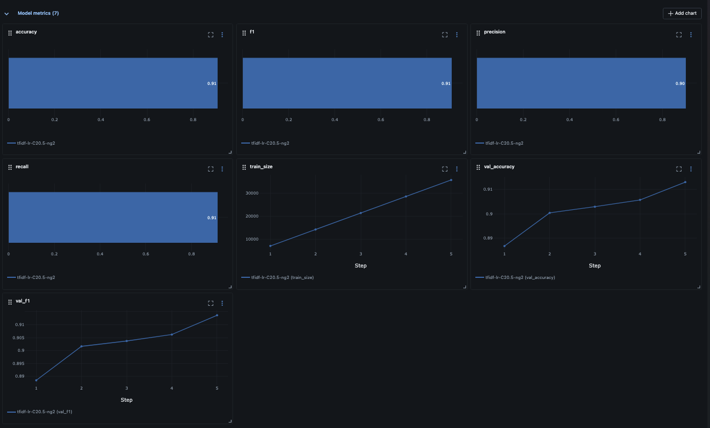
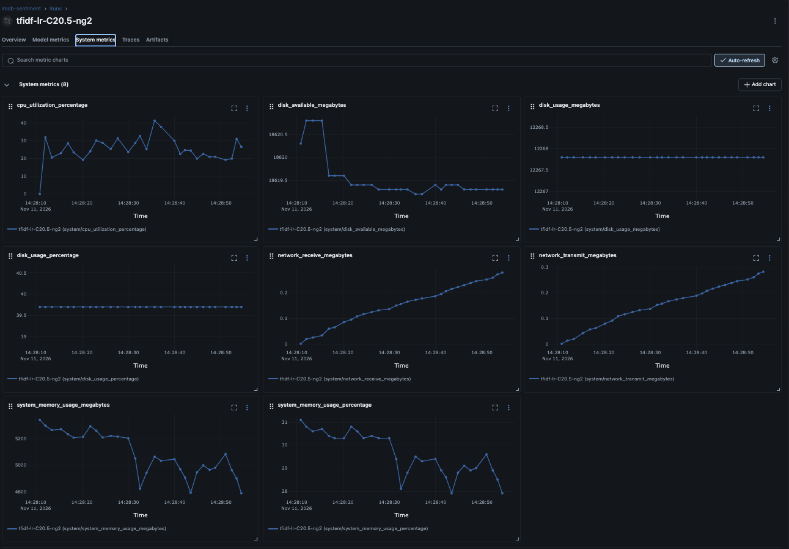
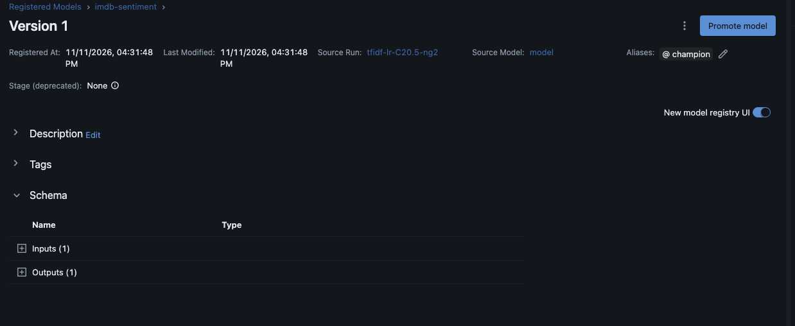

# IMDB atsiliepimų nuotaikos klasifikatorius: U1 MLOps projektas

Atkartojamas DVC pipeline'as (`prepare → train → evaluate`) ir savas MLflow Tracking Server lokaliame `kind` klasteryje.
Modelis: TF-IDF + logistinė regresija, duomenys `stanfordnlp/imdb`. Išbandyta macOS 26 (Apple Silicon, Docker Desktop).

- **Portai:** MLflow UI ir API http://127.0.0.1:5050 (kind NodePort 30500, tik `127.0.0.1`). Postgres tik klasterio viduje (`postgres:5432`).
- **Prisijungimai:** MLflow be prisijungimo. Postgres naudotojas ir atsitiktinis slaptažodis tik Kubernetes Secret `postgres-credentials` (sukuriamas 2 žingsnyje, Git'e jų nėra).
- **Rezultatai:** MLflow eksperimentas `imdb-sentiment`; `metrics.json` (`dvc metrics show`); KPI ir išmatuotos reikšmės `docs/requirements.md`; vaizdas ir Trivy `docs/docker-image.md`.

## Reikalavimai

- Docker su ≥ 6 GB RAM (MLflow ≈ 1,7 GiB, Postgres ≈ 50 MiB, kind mazgas).
- Laisvas `5050` portas (`5000` macOS užima AirPlay Receiver).

| Įrankis                          | Versija                              |
| -------------------------------- | ------------------------------------ |
| Docker Desktop                   | 28.5                                 |
| kind                             | 0.33.0                               |
| kubectl                          | 1.34                                 |
| uv (Python 3.12 parsiunčia pats) | 0.10                                 |
| DVC, MLflow                      | 3.67.1, 3.17.2 (`requirements.txt`)  |
| Trivy, gh                        | 0.76, 2.76 (tik vaizdo publikavimui) |

```sh
brew install kind kubectl uv trivy gh
```

## Paleidimas nuo nulio

### 1. Repo ir Python aplinka

```sh
git clone https://github.com/nojusbuc/mlops-u1.git && cd mlops-u1
uv venv --python 3.12 .venv && uv pip install --python .venv/bin/python -r requirements.txt
source .venv/bin/activate
```

### 2. Klasteris ir MLflow

Pirmą kartą siunčiami Postgres ir MLflow vaizdai (~1,5 GB), tai užtrunka kelias minutes. Pabaigoje `curl` atsako `OK`.

```sh
kind create cluster --config k8s/kind-config.yaml
kubectl apply -f k8s/namespace.yaml
kubectl -n mlops-u1 create secret generic postgres-credentials \
  --from-literal=POSTGRES_USER=mlflow --from-literal=POSTGRES_DB=mlflow \
  --from-literal=POSTGRES_PASSWORD="$(python3 -c 'import secrets; print(secrets.token_hex(16))')"
kubectl apply -k k8s/
kubectl -n mlops-u1 rollout status deploy/mlflow --timeout=300s
curl -sf http://127.0.0.1:5050/health; echo
```

UI: http://127.0.0.1:5050.

### 3. Duomenys

DVC remote yra lokalus katalogas `../mlops-u1-dvcstore` (šalia repo):

```sh
dvc pull
```

Jei remote katalogo nėra (kitas kompiuteris), duomenys parsiunčiami iš Hugging Face fiksuotos revizijos; `git diff` turi būti tuščias, t. y. md5 sutampa su `data/raw.dvc`:

```sh
curl -fsSL --create-dirs -o "data/raw/#1.parquet" \
  "https://huggingface.co/datasets/stanfordnlp/imdb/resolve/e6281661ce1c48d982bc483cf8a173c1bbeb5d31/plain_text/{train,test}-00000-of-00001.parquet"
dvc commit -f data/raw.dvc
git diff --exit-code data/raw.dvc && echo "duomenys sutampa"
dvc push
```

### 4. Pipeline: trys run'ai

`train.py` be `MLFLOW_TRACKING_URI` nepasileidžia, kad run'ai nepatektų į lokalų `mlruns/`.
`params.yaml` commit'inamas **prieš** `dvc repro`: run'o `git_commit` tag'as tada turi lygiai tuos parametrus, ir `reproduce.py` gali jį atkurti.

```sh
export MLFLOW_TRACKING_URI=http://127.0.0.1:5050
for c in 0.1 10.0 1.0; do
  python -c "import yaml,sys; p=yaml.safe_load(open('params.yaml')); p['train']['C']=float(sys.argv[1]); yaml.safe_dump(p,open('params.yaml','w'),sort_keys=False)" $c
  git commit -m "params: C=$c" params.yaml
  dvc repro
  git add dvc.lock metrics.json models/run_id.txt && git commit -m "run: C=$c"
done
dvc push
```

Pakeitus `train` parametrą, `dvc status` rodo pasikeitusį `train`; `dvc repro` perleidžia tik `train` ir `evaluate`. `prepare` perleidžiamas tik pakeitus `prepare` parametrus (`test_size`, `seed`), jo kodą arba duomenis. `dvc.lock` pasikeičia pakeisto stage'o `params` ir jo išvesčių md5.

### 5. Rezultatai

- MLflow UI → eksperimentas `imdb-sentiment`; run'ai `tfidf-lr-C<C>-ng<ngram_max>`: parametrai, `accuracy`, `f1`, `precision`, `recall`, tag'ai `git_commit`, `git_dirty`, `dvc_raw_md5`, modelis, duomenų rinkinys, `eval/confusion_matrix.json`.
- `dvc metrics show`; palyginimas `dvc params diff HEAD~4` ir `dvc metrics diff HEAD~4`.
- Imtys nesidalija atsiliepimais (NFR-02), turi išvesti `0`:

```sh
python -c "import pandas as pd; a=pd.read_parquet('data/processed/train.parquet'); b=pd.read_parquet('data/processed/test.parquet'); print(len(set(a.text) & set(b.text)))"
```

### 6. Istorinio run'o atkūrimas

Reikia švaraus darbo medžio ir šakos (skriptas grįžta su `git checkout --force`). `<run_id>` matomas MLflow UI arba `models/run_id.txt`.

```sh
time python reproduce.py <run_id>
```

```
accuracy: original=0.9078 reproduced=0.9078 delta=0.0000
f1: original=0.9090 reproduced=0.9090 delta=0.0000
REPRODUCED in 23s -> new run d8ebe1c086734cbf88e0c60265d9ca95
```

### 7. Mokymo Docker vaizdas

Publikuotas vaizdas (amd64 + arm64) pasileidžia be build'o ir log'ina run'ą į klasterio MLflow. macOS/Windows Docker Desktop kompiuterį pasiekia per `host.docker.internal`; Linux pridėkite `--add-host=host.docker.internal:host-gateway`.
Vaizde tik mokymas (`train.py`), todėl tokio run'o metrikų nėra; jas skaičiuoja `evaluate` stage'as.

```sh
docker run --rm -e MLFLOW_TRACKING_URI=http://host.docker.internal:5050 ghcr.io/nojusbuc/mlops-u1/train:<sha-tag iš docs/docker-image.md>
```

Savas vaizdas, Trivy ir publikavimas į GHCR (reikia `gh auth refresh -h github.com -s write:packages,read:packages`):

```sh
SHA=$(git rev-parse --short=8 HEAD)
docker build -f docker/Dockerfile.train --build-arg GIT_COMMIT=$SHA -t mlops-u1/train:sha-$SHA .
trivy image -q --scanners vuln --severity HIGH,CRITICAL --format table -o docs/trivy-train.txt mlops-u1/train:sha-$SHA
trivy image -q --scanners vuln --severity CRITICAL --exit-code 1 mlops-u1/train:sha-$SHA
bash scripts/publish.sh
```

`scripts/publish.sh`: CRITICAL vartas, `docker login` su `gh` token'u, amd64 + arm64 vaizdas į `ghcr.io/<user>/mlops-u1/train:sha-<commit>`.

### 8. Mokymas kaip Kubernetes Job

ConfigMap `training-config` duoda Job'ui MLflow adresą `http://mlflow:5000` (Service vardas klasteryje) ir hiperparametrus.

```sh
kubectl -n mlops-u1 delete job train --ignore-not-found
kubectl apply -f k8s/jobs/
kubectl -n mlops-u1 wait --for=condition=complete job/train --timeout=600s
kubectl -n mlops-u1 logs job/train
```

Sukurto Job'o keisti negalima, todėl prieš naują paleidimą senas ištrinamas. Kitam `C` pakeiskite `k8s/jobs/configmap-training.yaml`.

## Išvalymas ir persikrovimas

```sh
kind delete cluster --name mlops-u1
```

PVC (`postgres-data`, `mlflow-artifacts`) išlieka ištrynus Pod'us (`kubectl -n mlops-u1 delete pod -l app=mlflow`), bet dingsta kartu su klasteriu.
Po kompiuterio perkrovimo: `docker start mlops-u1-control-plane`, po minutės Pod'ai vėl `Running`, run'ai vietoje.

## Dažnos klaidos

| Klaida                                           | Priežastis ir sprendimas                                                                                                                                         |
| ------------------------------------------------ | ---------------------------------------------------------------------------------------------------------------------------------------------------------------- |
| `MLFLOW_TRACKING_URI is not set`                 | Šiame terminale: `export MLFLOW_TRACKING_URI=http://127.0.0.1:5050`                                                                                              |
| `curl 127.0.0.1:5050` atmeta ryšį                | MLflow Pod'as dar kyla (`kubectl -n mlops-u1 get pods`), arba klasteris sukurtas ne su `k8s/kind-config.yaml` (portų susiejimas nustatomas tik kuriant klasterį) |
| `port is already allocated` kuriant klasterį     | 5050 užimtas: pakeiskite `hostPort` `k8s/kind-config.yaml` ir `MLFLOW_TRACKING_URI`                                                                              |
| `403` / `Invalid Host header` iš MLflow          | Kliento host'o nėra `--allowed-hosts` sąraše `k8s/mlflow/deployment-mlflow.yaml`                                                                                 |
| Job'as `ImagePullBackOff`                        | GHCR paketas privatus arba tag'as neegzistuoja: padarykite paketą viešą ir patikrinkite `image:` `k8s/jobs/job-train.yaml`                                       |
| `dvc: command not found` / `ModuleNotFoundError` | Neaktyvuotas venv: `source .venv/bin/activate`                                                                                                                   |
| `reproduce.py`: `Uncommitted changes`            | Commit'inkite arba `git stash` pakeitimus                                                                                                                        |

## Duomenys ir licencija

- **Duomenys:** Maas, A. L., Daly, R. E., Pham, P. T., Huang, D., Ng, A. Y., & Potts, C. (2011). Learning Word Vectors for Sentiment Analysis. _ACL 2011_. Gauta per Hugging Face `stanfordnlp/imdb`, revizija `e6281661ce1c48d982bc483cf8a173c1bbeb5d31`. Naudojama mokymosi tikslais.
- **Kodas:** MIT, žr. [LICENSE](LICENSE). Rašyta kartu su Claude.

metric screenshots:






