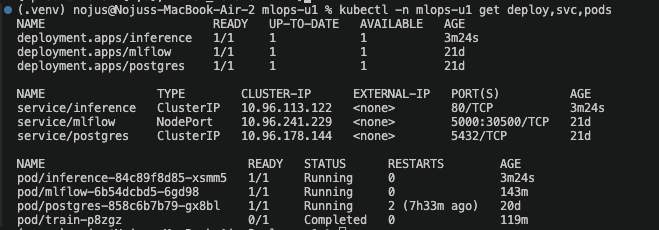

# U2 ataskaita

## Kas padaryta

- **R1:** mokymosi kreivė kaip metrikos per žingsnius (`train_size`, `val_accuracy`, `val_f1`, 5 žingsniai po 20–100 %
  mokymo imties, 0,887 → 0,913), 8 sistemos metrikos (psutil, kas 1 s), `log_input` su digest'u, tag'ai `git_commit`,
  `git_dirty`, `dvc_raw_md5`, `seed`, modelis su `requirements-train.txt` aplinka. Optuna (TPE, 5 atsitiktiniai pradiniai
  bandymai): tėvinis run'as `hpo-optuna` su 10 įdėtinių `trial-*` per 65 s, paieška `C` (0,01–100, log), `max_features`
  (10k / 25k / 50k), `ngram_max` (1–2), vertinama validacijos imtyje (10 % mokymo). Geriausi `C` 20,5, 50 000, bi-gramos:
  `val_accuracy` 0,9130; perkelti į `params.yaml`.
- **R2:** `log_model(name="model", registered_model_name="imdb-sentiment")`; v1 iš `dvc repro`, v2 iš Job'o.
  `scripts/promote.py` perkelia `@champion` (pagal `models/run_id.txt` arba `--version`). API įkelia
  `models:/imdb-sentiment@champion` (`src/serve/model_loader.py`).
- **R3:** MLflow basic auth (`--app-name basic-auth`), slaptažodžiai tik Secret `mlflow-credentials`. Job `train` iš
  `ghcr.io/nojusbuc/mlops-u1/train:sha-d029f527`: ConfigMap `training-config` (URI, `C`, `max_features`, `ngram_max`),
  prisijungimai per `secretKeyRef`; `Complete` per 110 s, run'as `d7c16ae8` su `git_commit` `d029f527`, registruota v2.
- **R4:** FastAPI `src/serve/app.py` (modelis įkeliamas vieną kartą lifespan'e), vaizdas `docker/Dockerfile.serve` be modelio,
  Deployment (1 replika, readiness ir liveness `/health`, ne root) + ClusterIP Service `inference`, prieiga per
  `port-forward`. Apkrovos testas: p95 13,4 ms (`docs/load-test.md`).
- **R5:** `.github/workflows/ci.yml`: `test` (ruff, pytest: 7 testai, API su netikru modeliu) → `build` (serve vaizdas
  amd64 + arm64 į GHCR `sha-<commit>`, tik po sėkmingų testų). Žalias run'as: _[nuoroda]_.
- **R6:** `.github/workflows/cd.yml` self-hosted runner'yje (Mac, pasiekia kind ir MLflow): pytest → `dvc repro` →
  `scripts/quality_gate.py` → `promote.py` → manifestas (vaizdo tag'as, `model-version` anotacija) → `kubectl apply` →
  `/health`. Žalias: _[nuoroda]_, raudonas: _[nuoroda]_.
- **R7:** `docs/requirements.md` v1.6: nauji FR-06–FR-11, NFR-10–NFR-15 su išmatuotomis reikšmėmis.

Ekrano nuotraukos (`docs/img/`): [mokymosi kreivė](img/train-metrics.png), [sistemos metrikos](img/system-metrics.png),
_[HPO medis]_, [`@champion`](img/registry-champion.png), [Job `Complete`](img/job-complete.png),
[Job run'as UI](img/job-run.png), [`/predict`](img/api-predict.png), [k8s ištekliai](img/k8s-serving.png),
_[CI žalias]_, _[CD žalias]_, _[CD raudonas]_, _[rollback]_.

## Architektūra

```
git push → CI (GitHub cloud): ruff → pytest → serve vaizdas sha-<commit> → GHCR
         → CD (self-hosted runner, Mac): pytest → dvc repro → quality_gate.py → promote.py (@champion)
                                         → manifestas (tag'as, model-version) → kubectl apply → /health
kind klasteris, namespace mlops-u1: postgres ← mlflow (basic auth, 127.0.0.1:5050) ← job/train, deploy/inference
```

Modelio vaizde nėra: API paleidimo metu įkelia `@champion` iš MLflow, todėl naujam modeliui naujo vaizdo nereikia.
CD pakeičia `model-version` anotaciją, Kubernetes pakeičia Pod'ą, o naujas Pod'as įkelia naują `@champion`.
CI build'ina tik serve vaizdą: mokymo vaizde yra `data/processed/`, kurių nėra Git'e (DVC remote lokalus), todėl jis
publikuojamas `scripts/publish.sh`.



## Matavimai

| Kas                          | Reikšmė                                                            |
| ---------------------------- | ------------------------------------------------------------------ |
| HPO (10 bandymų)             | 65 s, geriausias `val_accuracy` 0,9130                             |
| Mokymas                      | 45 s `dvc repro`, 110 s k8s Job                                    |
| Žalias CD paleidimas         | _[R6: trukmė, accuracy]_                                           |
| Raudonas CD paleidimas       | _[R6: trukmė, sustojo ties vartu]_                                 |
| Rollback                     | _[R6: trukmė]_                                                     |
| p50 / p95 / p99              | 4,1 / 13,4 / 23,1 ms (200 nuoseklių užklausų, per `port-forward`)  |
| Pralaidumas                  | 173 užklausų/s, vienas klientas, 0 klaidų                          |
| Modelis                      | 2,3 MB (`model.pkl`)                                               |
| Serve vaizdas `sha-1418dd44` | rootfs 780 MB; Trivy CRITICAL 0, HIGH 51 (Debian bazė, be pataisų) |

## Žalias, raudonas ir rollback

_[R6: žalio CD paleidimo nuoroda ir ištraukos: quality gate PASS, promote, smoke test]_

```
[R6: gate: accuracy ... >= 0.8800 -> PASS]
[R6: imdb-sentiment@champion -> version N (run ...)]
[R6: {"status":"ok", ... "version":"N" ...}]
```

_[R6: raudono CD paleidimo nuoroda (`gate.min_accuracy: 0.99`): FAIL, promote / manifestas / deploy praleisti, `/health` liko N]_

```
[R6: gate: accuracy ... < 0.9900 -> FAIL]
```

_[R6: rollback: `promote.py --version N` + `rollout restart`, `/health` prieš ir po]_

```
[R6: rollback terminalo išvestis]
```

## Kas neveikė / ką teko spręsti

1. **MLflow slaptažodis:** basic auth reikalauja ≥ 12 simbolių, todėl `admin` slaptažodis pakeistas per REST API, o Secret
   perkurtas.
2. **`publish.sh` atsisakė publikuoti:** Trivy ataskaita (`-o docs/trivy-train.txt`) pakeitė sekamą failą, todėl medis
   buvo nebuvo clean. Tvarka: publikavimas, tada ataskaita.
3. **Job paleido seną vaizdą:** naujas vaizdas sukurtas, bet `job-train.yaml` tag'as neatnaujinau. Reikia nuoseklumo. Tag'as atnaujintas
   (`4b8ae37`) ir Job'as paleistas iš naujo.
4. **CI build kabojo „Post Run“ žingsnyje:** `docker/build-push-action` bandė įkelti build ataskaitą į GitHub ir gaudavo
   klaidą. AI'us rekomendavo išjungt `DOCKER_BUILD_RECORD_UPLOAD: false`; pats vaizdas jau buvo įkeltas, bet tikėtina incidento sukelta problema.
5. **Runner'is repo kataloge:** GitHub komandos sukūrė `actions-runner/` repo viduje (su runner'io raktais ir būsima
   repo kopija). Perkėliau į `~/actions-runner`.
6. **GitHub Actions incident'as:** naujas CI run'as stovėjo „Queued“ ilgiau nei 15 min, o ankstesnis kabojo „In progress“, nukillint neįmanoma („Cannot cancel a workflow run that is not in progress“). GitHub Status rodo
   Actions sturikimą. Turbūt ne aš sukėliau, bet niekada nežinosim.

## Nedaryta

E1 (GPU prabanga 2026-aisiais), E2 (Prefect), E3 (HPA, Locust), E4 (ONNX), E5 (Argo CD): dėl laiko.

## Kiek laiko užtruko

10h
